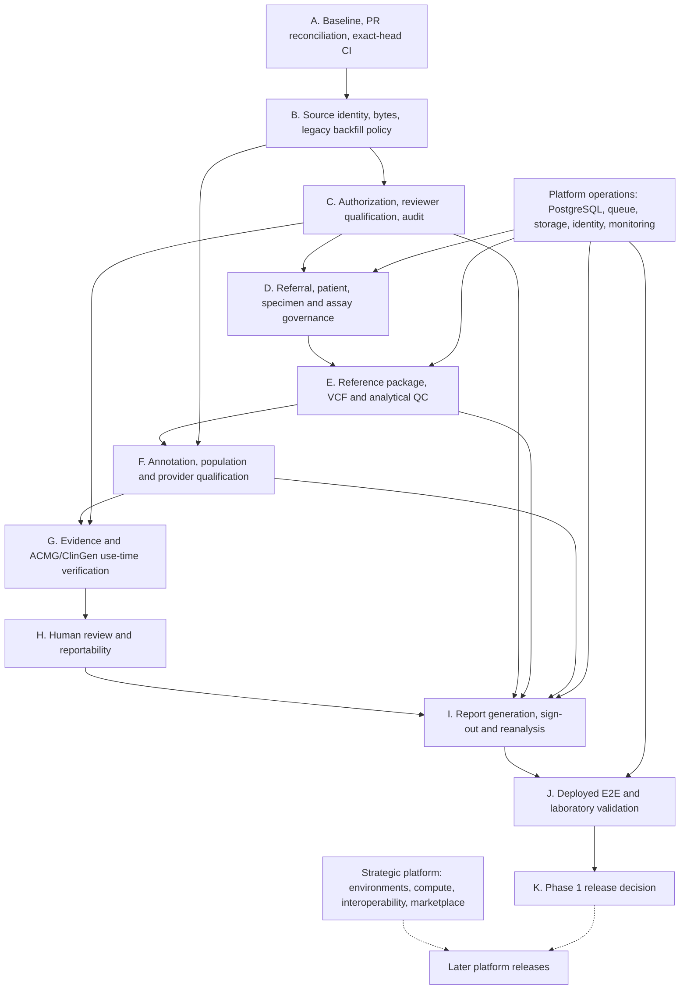

# SIRALOOM Master Defect Register & Dependency Roadmap

**Baseline date:** 2026-11-12  
**Repository:** `SayedaRehmat/SIRALOOM`  
**Baseline branch:** `integration/stage1-referral-provenance-20261110`  
**Reconciled PR:** [#321 — Integration: artifact validation, clinical accession and referral provenance](https://github.com/SayedaRehmat/SIRALOOM/pull/321)  
**Current PR head inspected:** `0f375367293a5fa20739cedaf478b87a41cb1455`  
**Status:** Initial evidence-backed engineering baseline; not a declaration of release or clinical readiness.

This document is the controlling engineering roadmap for prioritization and dependency ordering. It consolidates the current PR #321 state, the repository's clinical workflow specification, Stage 1 matrix, release status, engineering documents, migrations, tests and the previously agreed SIRALOOM platform strategy.

It does **not** replace detailed specifications, controlled laboratory procedures, or test evidence. When older status documents conflict with newer code/CI evidence, the discrepancy is recorded here and must be reconciled at source. Absence of evidence is marked **unverified**, not assumed to be a defect or a pass.

---

## 1. Decision rules and status vocabulary

### Priority

- **P0 — safety / integrity blocker:** could permit unsafe scientific evidence use, unauthorized clinical work, corrupted provenance, or an invalid clinical release if not controlled. Must remain fail-closed.
- **P1 — release-critical:** required before a credible Phase 1 production deployment or controlled laboratory qualification.
- **P2 — important hardening:** needed for operational maturity, governance completeness, or broad deployment.
- **P3 — strategic roadmap:** future platform capability, not a current Phase 1 defect.

### Evidence status

- **Implemented (reported):** code/documentation says the control exists; this label alone is not proof of current-head verification.
- **Software-verified (specific commit):** a named automated run or reproducible test result exists for the exact commit stated.
- **Partial:** some controls exist, but the requirement is not fully covered.
- **Open:** the repository/PR explicitly records remaining work.
- **Unverified:** repository-wide call-site or runtime audit is still required.
- **External validation required:** must be demonstrated by a qualified laboratory, deployment operator, independent reviewer, or other appropriate authority; software tests cannot close it.

A feature moves through four distinct gates: **designed → implemented → software-verified → externally/laboratory-validated**. These are not interchangeable.

---

## 2. Current repository and PR #321 baseline

### PR facts

- PR #321 is open and draft; no merge or production deployment is recorded.
- It contains 119 changed files, 12,379 additions, 413 deletions and 467 commits at the time inspected.
- Its stated integration scope reconciles earlier work from PRs #297, #319 and #247, then adds the Stage 1 case/request/accession and clinical-readiness foundation.
- The current PR head inspected is `0f375367293a5fa20739cedaf478b87a41cb1455`.
- GitHub reported `mergeable: false` in the metadata snapshot. Treat this as an integration blocker to investigate; do not infer the exact cause without a fresh merge-conflict check.

### CI and deployment evidence

- PR description records CI run [#43173071765](https://github.com/SayedaRehmat/SIRALOOM/actions/runs/43173071765) successful on `8443aedb624be448abc70fdbfa23f9b0b1156793`: backend 2,358 passed, 56 skipped, 1 warning; frontend behavior tests, production build/container, Compose validation, PostgreSQL migrations and worker-loss integration were reported successful.
- That run is **not on the current PR head**. Subsequent code commits exist.
- Current-head combined status showed Vercel success. The workflow-run lookup for the current head returned no PR-triggered workflow runs. Therefore the current head is **not yet qualified by a fresh full CI run** in this baseline.
- Earlier run #42989916071 is historical evidence only and is superseded by the later run above.
- No test result should be attributed to `0f3753...` unless a run for that exact SHA is produced.

### Major PR #321 work already represented

1. Durable artifact-validation dispatch, retry/worker-loss recovery and VCF validation/conformance.
2. Clinical request revisions, accession decisions, external-referrer verification, capability history and legacy reconciliation state.
3. Clinical analysis gates that recheck accepted request/revision, accession decision, specimen/sample mapping, artifact identity and workflow eligibility.
4. SNV/small-indel eligibility boundaries with unsupported symbolic/structural and sentinel cases failing closed.
5. Assay identity/version governance and immutable assay-validation submissions/decisions, including independent approval, scope, performance specifications, evidence manifest and expiry/suspension/withdrawal handling.
6. Six-component runtime attestation for BCFtools, HTSlib, native toolchain lock, Python dependency lock, SIRALOOM workflow source and container/host runtime identity; Kubernetes and host-broker Docker/bare-metal paths are documented.
7. Provider raw-response capture/retention governance, exact-byte integrity, approval expiry/revocation, retry idempotency, immutable source-release snapshots and lineage propagation.
8. ACMG/report use-time checks and reanalysis lineage checks.

These are repository/PR claims to reconcile with actual call sites and tests; they do not mean every operational, scientific or laboratory requirement is closed.

---

## 3. Prioritized master defect register

### A. Evidence integrity, source governance and auditability

| ID | Priority | Finding / required outcome | Current evidence state | Dependency / closure evidence |
|---|---|---|---|---|
| GOV-01 | P0 | Backfill or restage legacy local ClinVar, ClinGen, HPO and secondary-population releases that predate immutable source-release snapshots. Never silently trust unlinked historical evidence. | Explicitly open in PR #321; fail-closed behavior is described for local evidence without a snapshot. | Inventory affected installations/evidence; approved restaging/backfill procedure; verify source identity, artifact bytes, digest and downstream links; negative tests for unlinked legacy records. |
| GOV-02 | P0 | Prove every scientific evidence-use route revalidates source-release and response-artifact identity/bytes immediately before use, including retries, resumed workflows, manual ACMG, reanalysis and sign-out. | Shared gates and several call paths are described; complete repository-wide path coverage remains unverified. | Build a call-site matrix from adapter → persistence → evidence → ACMG → report; add bypass/negative tests for every entry point. |
| GOV-03 | P1 | Establish publisher authenticity where claimed, distinct from local SHA-256 byte consistency. | PR explicitly distinguishes publisher-checksum match from locally captured digest. | Per-provider trust policy, independently verified publisher checksum/signature or trusted channel evidence; ensure UI/report never overstate local digest as publisher authenticity. |
| GOV-04 | P1 | Complete qualified-reviewer credential and role/competence governance for retention approvals, assay validation and clinical decisions. | PR lists reviewer credential qualification as outstanding; capability assignment alone does not establish professional qualification. | Governed qualification records, scope, expiry, verification evidence, revocation and tests at each authorization boundary. |
| GOV-05 | P1 | Complete independent legal/provider-terms review for retention permissions and source use. | Explicitly open in PR #321. | Legal review record per provider/release/terms; map permission scope to actual retention, caching, redistribution and audit behavior. |
| GOV-06 | P2 | Decide and implement configurable dual-control policy where required for high-risk approvals and exceptions. | Optional dual-control remains outstanding; some procedures already require independent submitter/approver. | Risk assessment, policy configuration, separation-of-duties enforcement and adversarial tests. |
| GOV-07 | P2 | Anchor the hash-linked audit chain outside the primary database/storage trust boundary. | External audit-chain anchoring remains outstanding. | Threat model, independent immutable destination, verification/restore procedure and tamper-detection tests. |
| GOV-08 | P1 | Verify all retention approval lifecycle transitions and PostgreSQL races on the current head: expiry vs workers, revocation vs retry, verification vs expiry, sign-out vs revocation. | Approval-row locking and four concurrency tests are in PR #321; exact-current-head full CI has not been observed in this baseline. | Run the tests against PostgreSQL with independent sessions; strengthen the evidence-verification/expiry test so one transaction actively performs expiry while another verifies; capture exact-head CI. |

### B. Clinical intake, assay governance and specimen/QC controls

| ID | Priority | Finding / required outcome | Current evidence state | Dependency / closure evidence |
|---|---|---|---|---|
| CLIN-01 | P1 | Complete specimen identity, collection/receipt provenance and lifecycle events; make required identity evidence mandatory for clinical intake. | Stage 1 matrix marks specimen receipt/history partial; current controls include case-scoped specimen identity and VCF sample mapping. | Define lifecycle states/events, identity checks, custody/receipt evidence and exception handling; PostgreSQL/API/UI tests. |
| CLIN-02 | P1 | Complete controlled patient identity and requester provenance; distinguish verified identity from entered demographic/context fields. | Stage 1 matrix marks traceability partial. | Approved identity-verification procedure and evidence model; access controls, audit and correction history. |
| CLIN-03 | P0 | Complete end-to-end clinical readiness composition: accepted request, verified accession, valid specimen/sample, active assay, current assay validation, QC acceptance, resource/toolchain readiness, confirmation requirements, qualified review and authorized sign-out. | Multiple gates are implemented, but Stage 1 matrix still marks overall readiness partial and specimen/QC items remain open. | One explicit readiness decision contract; trace every creation/dispatch/worker/report/sign-out boundary; negative tests for each missing/expired/revoked prerequisite. |
| CLIN-04 | P1 | Complete upstream sequencing/calling and specimen-level QC provenance, thresholds, review, exceptions and clinical gates. | Analytical QC foundations exist; PR #321 explicitly lists specimen lifecycle/QC provenance and end-to-end analytical QC gates as remaining. | Define intended-use QC metrics and acceptance policy with laboratory; persist source artifact, assay, caller/pipeline, thresholds, observations, reviewer and decision; fail-closed integration tests. |
| CLIN-05 | P1 | Complete assay-validation evidence content/integrity checks, approver qualification, change-control linkage and ongoing monitoring. | Immutable submissions/decisions and runtime binding are described as implemented; evidence authenticity/content review and governance remain open. | Verify every evidence manifest artifact/hash at approval and use; qualified approver records; change/suspension/expiry monitoring tests. |
| CLIN-06 | P2 | Complete assay-validation administration and operational UI. | PR explicitly lists administration UI as outstanding. | Backend governance stable first; then role-aware UI, audit visibility and usability tests. |
| CLIN-07 | P1 | Complete quarantine, controlled release and operational exception review/expiry procedure. | Stage 1 matrix marks rejection/quarantine/exceptions partial; some rejection, needs-information and procedure-approval controls exist. | State model, independent approval, reason/evidence, expiry/revocation, re-entry controls and workflow/API tests. |
| CLIN-08 | P1 | Verify referral verification and procedure-based exception rules in every acceptance path, including legacy reconciliation and API bypasses. | PR #321 describes verification-before-acceptance and approved-procedure exceptions; full call-site proof remains required. | Acceptance-path matrix, two-person procedure approval tests, exception expiry and audit tests. |

### C. VCF, reference, annotation and scientific correctness

| ID | Priority | Finding / required outcome | Current evidence state | Dependency / closure evidence |
|---|---|---|---|---|
| SCI-01 | P0 | Bind the exact reference package identity/digest (FASTA, indexes, manifest, contig dictionary and build) into the immutable analysis snapshot and verify it at use. | Stage 1 matrix marks reference/build consistency partial and calls for immutable reference package identity/digest. | Reference package registry and immutable snapshot; REF/contig/build mismatch negative tests; report provenance. |
| SCI-02 | P0 | Establish frozen golden datasets and independent expected outputs for normalization, annotation, population, evidence and ACMG/ClinGen behavior. | Scientific workflow specification requires golden datasets; release status says benchmark/scientific validation remains a gate. | Curated/versioned corpus covering SNVs, indels, repeats, multiallelics, MNVs, sex chromosomes, mitochondrial scope, contig aliases, symbolic alleles and failures; independent review and regression runs. |
| SCI-03 | P1 | Reconcile supported VCF version policy across documents and implementation. | Documentation discrepancy: acceptance matrix describes strict VCF 4.2/4.3 while Stage 1 matrix says 4.0–4.5. | Inspect parser/tests and provider/tool compatibility; decide supported versions; update docs, fixtures and API errors consistently. |
| SCI-04 | P1 | Verify normalization policy against pinned reference/tool versions and laboratory-approved golden outputs; keep normalization distinct from GA4GH VRS canonicalization. | Normalization and canonical identity foundations exist; scientific specification requires frozen policy after golden validation. | SCI-01 and SCI-02; deterministic command/configuration snapshots; indel/MNV/multiallelic/REF mismatch tests. |
| SCI-05 | P1 | Complete production local VEP/cache/reference packaging and qualification; do not rely on a trial/non-commercial provider as a clinical diagnostic service. | Workflow specification describes local pinned VEP/cache strategy; release status explicitly states GeneBe is research/educational, non-commercial in this configuration. | Provider qualification, cache/resource digest, licenses/terms, offline operation, benchmark concordance and change-control evidence. |
| SCI-06 | P1 | Verify provider response byte retention and provenance across every adapter and failure mode; make unavailable bytes explicit rather than fabricating raw evidence. | GeneBe/gnomAD/VEP/ClinGen capture paths are described; provider coverage and edge cases still require call-site audit. | Adapter inventory, HTTP/local-output byte capture tests, empty/error/truncated response tests, deterministic request fingerprints. |
| SCI-07 | P1 | Verify population semantics: missing ≠ zero; global, ancestry, local and cohort frequencies remain distinct; no mislabeled ancestry inference. | Population model and gnomAD MID context exist; scientific validation and resource availability remain required. | Per-population fixtures, provenance checks, absent/zero distinction, ancestry labels and report rendering tests. |
| SCI-08 | P1 | Verify ClinGen VCEP specification selection/version applicability and fail-closed behavior when unavailable or ambiguous. | Specification says validated VCEP specifications supersede generic behavior and ambiguity must require review; complete corpus validation remains open. | Specification provider/version inventory, rule precedence tests, curated criterion cases and independent expert review. |
| SCI-09 | P1 | Preserve strict initial product scope: SNV/small indels only; unsupported SVs, breakends, GVCF blocks, telomere sentinels and unresolved spanning deletions must remain ineligible. | PR #321 says explicit fail-closed eligibility exists. | Keep adversarial fixtures and report limitations; no SV capability claim until separate validated workflow exists. |

### D. Interpretation, review, reporting and reanalysis

| ID | Priority | Finding / required outcome | Current evidence state | Dependency / closure evidence |
|---|---|---|---|---|
| INT-01 | P0 | Prove ACMG assessment cannot consume stale, unverified, unauthorized or source-unlinked annotation/population/evidence data. | PR describes pre-assessment verification; full entry-point and manual-resume audit remains unverified. | GOV-02 and SCI-06/07/08; tests for every ACMG entry/resume/retry path. |
| INT-02 | P1 | Verify interpretation evidence extraction, criterion assignment and combination logic against current ACMG/AMP and applicable ClinGen specifications; prevent annotation scores from becoming criteria automatically. | Assessment/review infrastructure exists; independent scientific validation is still required. | SCI-02 and SCI-08; criterion-level validation corpus, versioned rules and expert adjudication. |
| INT-03 | P1 | Verify human review independence, role qualification, rationale, evidence visibility, version history and conflict handling. | Versioned human review foundation exists; reviewer competence governance remains outstanding. | GOV-04; workflow/API permission tests and laboratory SOP. |
| INT-04 | P1 | Verify report generation and sign-out reconstruct the exact source snapshot and block if any evidence, QC, authorization, runtime or decision state changes. | Sign-out locks report/analysis/case and rechecks snapshot/evidence per code review and PR claims; current-head integration qualification required. | GOV-02, CLIN-03, SCI-01; concurrent decision/evidence revocation tests and report artifact integrity tests. |
| INT-05 | P1 | Verify reanalysis preserves historical results and source versions, checks parent artifacts before reuse, and binds child outputs to child analysis identity. | Reanalysis lineage controls are described and tested in PR; every stage/retry path still needs audit. | GOV-01/02; parent/child tests for annotation, population, evidence, reports and changed resources. |
| INT-06 | P2 | Complete reanalysis candidate lifecycle and historical-case reconciliation for legacy analyses. | PR says legacy reconciliation exists; explicit remaining review of legacy-case reconciliation is listed. | Define candidate creation, impact assessment, reviewer decision, scheduling, supersession and audit; test upgrades and historical cases. |
| INT-07 | P2 | Complete report language/format and clinical-vs-analytical report acceptance checks, including Arabic/RTL and all required provenance disclosures. | English/Arabic foundation and separate report layers exist; live qualification remains unverified. | Report golden fixtures, PDF/RTL rendering on production image, artifact checks and laboratory approval. |

### E. Platform operations, security and deployment

| ID | Priority | Finding / required outcome | Current evidence state | Dependency / closure evidence |
|---|---|---|---|---|
| OPS-01 | P1 | Demonstrate live PostgreSQL, Redis, API and worker execution in the intended deployment topology. | CI validates migrations/Compose; release status lists live infrastructure as a remaining gate. | Reproducible environment, health/readiness, worker execution, durable queue and operational evidence. |
| OPS-02 | P1 | Qualify production Firebase authentication, tenant authorization and multi-user behavior. | Server-side token/membership architecture documented; production auth and multi-user tests remain release gates. | Two-tenant adversarial tests, expired/revoked membership, object/storage access and live identity provider. |
| OPS-03 | P1 | Qualify production artifact storage, secrets and data lifecycle, including backup/restore, retention and recovery. | Local and cloud artifact integrity controls exist; real storage operations/restore qualification remains open. | Storage provider deployment, generation pinning, KMS/secret handling, backup restore drill, deletion/retention policy and byte-integrity tests. |
| OPS-04 | P1 | Execute deployed end-to-end VCF → report with public benchmark or authorized de-identified data. | Release status explicitly lists as not yet demonstrated. | OPS-01/02/03, SCI-02 and INT-04; reproducible run manifest and expected-output comparison. |
| OPS-05 | P1 | Execute frontend production build in the actual CI/deployment environment and validate authenticated clinical workflows. | PR reports a successful production build/container CI on an earlier commit; current-head full CI required. Older README notes sandbox npm installation limitations. | Exact-head CI, deployed UI tests, localization, role permissions and failure-state handling. |
| OPS-06 | P1 | Run deployed failure injection for worker loss, broker outage, storage interruption, duplicate delivery, retries and concurrent users. | Strong durable-dispatch/worker-loss software foundations and CI tests exist; live deployment failure qualification remains open. | OPS-01/03; controlled test plan, event/audit capture and recovery acceptance criteria. |
| OPS-07 | P2 | Qualify operational monitoring, alerting, capacity, backup ownership, incident response and disaster recovery. | Operational foundations and telemetry exist; complete production operational qualification not evidenced. | SLOs, runbooks, alert routing, restore/recovery objectives and tabletop/failure drills. |
| OPS-08 | P2 | Benchmark representative clinical workloads and large VCF/WGS-scale behavior; verify partition scheduler capacity and resource isolation. | Streaming partitions and resource-aware scheduler are implemented; README explicitly says WGS-scale production benchmarking is not claimed. | Representative datasets, defined hardware, CPU/RAM/I/O measurements, concurrency, queue fairness and repeatability. |
| SEC-01 | P1 | Complete independent security review of tenant isolation, authZ boundaries, storage paths/symlinks, secrets, logs and privileged worker/runtime trust. | Security foundations and artifact path checks exist; no complete independent security qualification is evidenced here. | Threat model, abuse cases, penetration review, tenant isolation tests, host-attestor hardening and remediation evidence. |

---

## 4. Dependency map and implementation order

The dependency graph below is the default order. Parallel work is allowed only where dependencies do not permit a bypass or invalidate upstream assumptions.

### Execution waves

| Wave | Focus | Exit condition |
|---|---|---|
| 0 | PR #321 integration, documentation reconciliation, exact-head CI | PR state/mergeability understood; full backend/frontend/PostgreSQL checks on exact head; no weakened safeguards. |
| 1 | Evidence integrity, source-release backfill, provider terms and reviewer governance | Every evidence source has explicit release identity and integrity state; legacy records safely restaged or remain blocked; approval races tested. |
| 2 | Clinical intake, specimen identity, assay validation, QC and clinical readiness | Every clinical analysis is bound to accepted request, specimen, assay, validation scope, QC and authorized roles; negative-path tests pass. |
| 3 | Reference, VCF, normalization, annotation and population scientific qualification | Frozen reference/toolchain/resource identity; golden datasets and provider concordance; scope limitations explicit. |
| 4 | ACMG/ClinGen, review, reportability, confirmation and reanalysis | Evidence cannot bypass verification; expert-reviewed criteria corpus; immutable and reproducible report/reanalysis lineage. |
| 5 | Deployment and operational qualification | Live infrastructure, tenant isolation, backup/restore, failure injection, authenticated UI and end-to-end benchmark evidence. |
| 6 | Laboratory qualification and release decision | Qualified laboratory has approved procedures, personnel, analytical/clinical validation and quality-system evidence for its intended use. |

---

## 5. PR #321 reconciliation register

| PR #321 area | Roadmap mapping | Reconciliation decision |
|---|---|---|
| Durable artifact validation / VCF conformance | OPS-06, SCI-03, SCI-09 | Treat as implemented software foundation; exact-head CI and independent conformance qualification remain. |
| Request revisions / accession / referrer verification | CLIN-02, CLIN-07, CLIN-08 | Treat as implemented foundation; patient identity, specimen lifecycle and full operational procedure remain partial. |
| Assay governance / validation lifecycle | CLIN-03, CLIN-05, CLIN-06 | Treat lifecycle and approval controls as implemented foundation; qualification evidence, approver competence, monitoring and UI remain. |
| Runtime attestation | CLIN-03, INT-04, OPS-06 | Newer PR description and runtime-attestation document describe six-component measurement/comparison and Kubernetes/host broker paths as implemented. Real host deployment and laboratory verification remain. |
| Evidence response retention / expiry / revocation | GOV-02, GOV-05, GOV-08 | Treat governed retention and locks as implemented foundation; verify all paths and current-head PostgreSQL races. |
| Immutable source-release snapshots | GOV-01, GOV-03, SCI-06 | New staged resources have immutable snapshots; legacy local resources need controlled backfill/restaging. Local digest is not publisher authenticity. |
| Annotation/population/evidence lineage | GOV-02, SCI-06, SCI-07, INT-01 | Several explicit paths are covered; complete adapter/call-site audit remains. |
| ACMG and report sign-out verification | INT-01, INT-04 | Treat use-time checks as implemented foundation; full call-path and current-head concurrency verification remains. |
| Reanalysis parent/child lineage | INT-05, INT-06 | Existing tests and code paths reported; full stage/retry and legacy reconciliation audit remains. |
| Runtime/assay UI, governance operations | CLIN-06, GOV-04, GOV-06 | Explicitly outstanding. |
| Legacy release backfill and laboratory qualification | GOV-01, SCI-02, OPS-04, CLIN-04 | Explicitly outstanding; cannot be closed by code-only work. |

### Documentation conflicts to reconcile

1. `docs/clinical/STAGE1_IMPLEMENTATION_MATRIX.md` still says runtime component digests are not compared to actual execution identity. This conflicts with the newer `docs/clinical/WORKER_RUNTIME_ATTESTATION.md` and PR #321 description. Update the matrix to reflect implemented software comparison while retaining real deployment/laboratory validation as open.
2. `docs/PHASE1_ACCEPTANCE_MATRIX.md` describes VCF 4.2/4.3, while the Stage 1 matrix says VCF 4.0–4.5. Resolve against parser implementation and tests; publish one supported-version policy.
3. Older README and milestone status snapshots contain historical test counts, migration heads and sandbox limitations. Do not present these as current branch status; update or clearly mark historical evidence.
4. Keep `docs/PHASE1_RELEASE_STATUS.md` release gates aligned with current PR/CI evidence, especially exact-head verification and production deployment.

---

## 6. Strategic platform roadmap (not Phase 1 defects)

These are agreed SIRALOOM product goals and must not be confused with current clinical defects or falsely marked implemented:

| Strategic ID | Capability | Timing / dependency |
|---|---|---|
| STR-01 | Customer-owned on-premises, private-cloud and HPC deployments | Initial commercial delivery; build on OPS-01 through OPS-07. |
| STR-02 | Reusable environment definitions and reproducible scientific execution | After stable deployment/runtime and resource identity. |
| STR-03 | Standards-based workflow and tool interoperability (evaluate CWL, GA4GH TRS/TES/WES/DRS, Nextflow, Snakemake) | Design and conformance planning can proceed; implementation follows stable execution/artifact contracts. |
| STR-04 | Scientific compute orchestration and resource marketplace | After tenancy, quotas, scheduling, isolation, provenance and billing boundaries are mature. |
| STR-05 | Marketplace for SIRALOOM and qualified external products | After product qualification, licensing, security, compatibility and support governance. |
| STR-06 | Multi-product SIRALOOM ecosystem beyond Variant | Separate product specifications and shared platform contracts. |
| STR-07 | SIRALOOM-hosted cloud | Deferred until funding and operational capacity permit; customer-owned deployment is the initial strategy. |
| STR-08 | Federated/global infrastructure | Long-term goal after identity federation, trust, governance, data locality and interoperability mature. |

---

## 7. Immediate next actions

1. Refresh PR #321 mergeability and exact-head CI; determine why GitHub currently reports `mergeable: false` before any merge consideration.
2. Reconcile the Stage 1 matrix's stale runtime-attestation statement and resolve the VCF version-policy discrepancy.
3. Run and, if necessary, repair the PostgreSQL approval-expiry/revocation/sign-out concurrency tests on a real PostgreSQL service. The evidence-verification race must include a concurrent expiry transition, not merely begin with an already-expired approval.
4. Build the adapter-to-evidence-to-ACMG/report call-site matrix and identify every legacy source-release gap.
5. Convert the highest-priority rows into bounded implementation/test batches, updating this register as each item gains evidence.

No merge, production deployment, or clinical-use authorization is implied by this roadmap.

---

## 8. Change log

- **2026-11-12:** Initial baseline created from PR #321 head `0f375367293a5fa20739cedaf478b87a41cb1455`, PR description, Stage 1 matrix, scientific workflow specification, Phase 1 release status, durable artifact validation specification, runtime attestation document, architecture/security/authorization documents, migrations and integration-test inventory.
